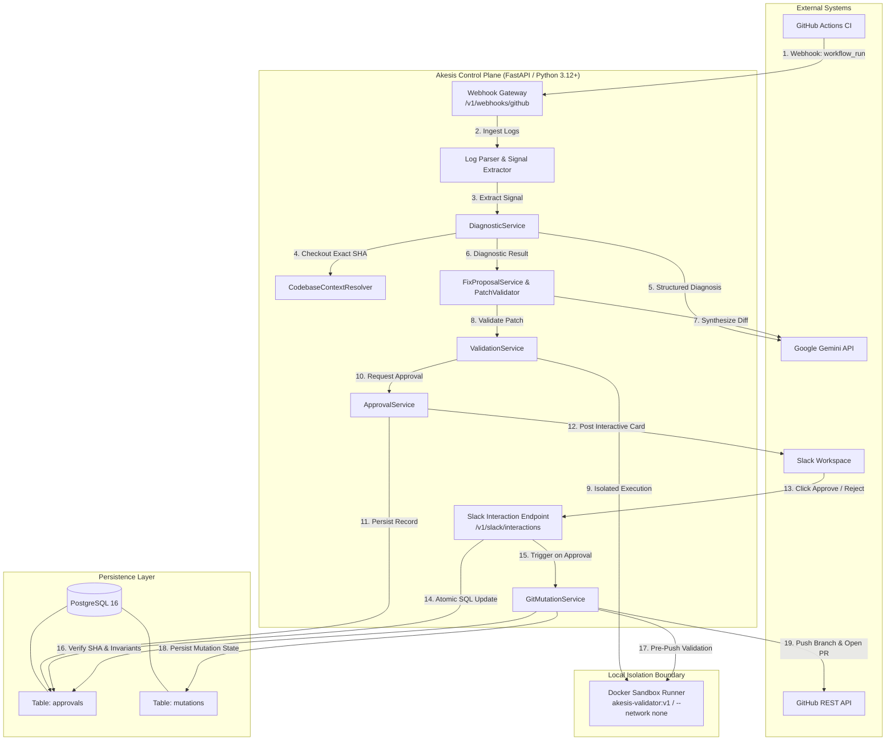

# Akesis

```text
Ecosystem: CRLabs AI
Category: Closed-Loop CI/CD Remediation Platform
Status: Production-Inspired Vertical Slice (V1)
Domain: Autonomous Pipeline Failure Triage, Validation & PR Delivery
```

Akesis is an intelligent engineering platform that closes the loop between CI/CD pipeline failures and verified code fixes. When a continuous integration build breaks on GitHub Actions, Akesis ingests the failure webhook, extracts error signals from raw logs, checks out the exact failing commit, generates an evidence-grounded unified diff via Google Gemini, empirically validates the patch inside an isolated Docker container, gates delivery behind human review in Slack, and opens an approval-authorized GitHub Pull Request.

Akesis is built on strict engineering-first principles: **reliability, deterministic containment, minimal diffs, and zero unvalidated or autonomous merging**.

---

## 1. How Akesis Works

Akesis executes a closed-loop, deterministic remediation lifecycle:

```
GitHub Actions Failure
        │
        ▼ (1. HMAC-SHA256 Ingestion)
Webhook Gateway (/v1/webhooks/github)
        │
        ▼ (2. ANSI Stripping & Traceback Regex)
Log Signal Extractor (FailureSignal)
        │
        ▼ (3. Exact Commit SHA Checkout & Windowing)
Codebase Context Resolver (EvidencePackage)
        │
        ▼ (4. Schema-Constrained Generation)
Gemini AI Diagnostic Engine (DiagnosisProposal)
        │
        ▼ (5. Diff Syntax & Budget Validation)
Fix Proposal Engine (FixProposal)
        │
        ▼ (6. Ephemeral Container & --network none)
Docker Sandbox Runner (ValidationResult)
        │
        ▼ (7. Interactive Block Kit Card & PostgreSQL Persistence)
Human Approval Gate (Slack Workspace)
        │
        ▼ (8. Reviewer Authorizes Fix: Approve)
Slack Interaction Gateway (/v1/slack/interactions)
        │
        ▼ (9. SHA Check, Branch Creation & Pre-Push Docker Validation)
Controlled Git Mutation Service (MutationRecord)
        │
        ▼ (10. Pull Request Opened on Dedicated Branch)
GitHub Pull Request Delivery
```

> [!IMPORTANT]
> **Human-in-the-Loop Guarantee:** Akesis **never automatically merges code** to base branches (`main`, `master`, `develop`). All automated fixes are delivered as reviewable Pull Requests created on dedicated branches (`akesis/fix/...`) only after explicit authorization by an engineer via Slack.

---

## 2. Key Engineering Properties

* **Exact Commit-SHA Alignment:** Fixes are grounded exclusively in source code checked out at the exact commit SHA that failed in CI (`GitRepositoryCheckoutManager`).
* **Structured AI Diagnostic Engine:** Diagnostic reasoning and unified diffs are generated using schema-constrained Pydantic models with Google Gemini (`gemini-1.5-flash`), with deterministic fallbacks if the model is unreachable.
* **Passive Untrusted Data Boundary:** CI logs and codebase comments are treated strictly as passive untrusted data, preventing prompt injection attacks from altering system instructions.
* **Strict Patch Budgets:** Patches are constrained to at most 2 files, 100 diff lines, and 4,000 characters. Workflow files (`.github/workflows/`), `.git/`, and `.env*` files are strictly protected from modification.
* **Ephemeral Docker Sandbox Isolation:** Proposed patches are validated inside dedicated Docker containers (`akesis-validator:v1`) with `--network none`, `--cap-drop ALL`, `--security-opt no-new-privileges`, non-root execution (`uid 1000`), 512MB RAM cap, and 1.0 CPU quota.
* **Verbatim Patch Application:** Patches are applied using `git apply --check` followed by `git apply` strictly without `--whitespace=fix` to guarantee that the generated patch matches validation verbatim.
* **Authoritative Decision Persistence:** Approval and mutation states are persisted in PostgreSQL 16 with atomic SQL transitions preventing race conditions, duplicate clicks, or illegal state jumps.
* **Cryptographic Perimeter Security:** Inbound GitHub webhooks require HMAC-SHA256 signature verification (`X-Hub-Signature-256`); Slack callbacks require HMAC-SHA256 (`X-Slack-Signature`) with 300-second timestamp replay protection.
* **Stale Commit Protection:** Before pushing a fix branch, Akesis verifies that the local workspace HEAD SHA matches the approved proposal SHA, aborting safely if the branch has advanced.

---

## 3. Architecture Overview



---

## 4. Current Feature & Capability Matrix

| Capability / Subsystem | Status | Verification & Notes |
| :--- | :---: | :--- |
| **GitHub Webhook Ingestion** | **Implemented** | Constant-time HMAC-SHA256 signature verification on `workflow_run` events. |
| **CI Log Signal Extraction** | **Implemented** | Strips ANSI codes; parses tracebacks, Pytest, Ruff, Mypy, and Pip failures. |
| **Exact Commit Context Retrieval** | **Implemented** | GitPython detached HEAD checkout; bounded 40-line windowing; path traversal prevention. |
| **Structured AI Diagnosis** | **Implemented** | Gemini REST API adapter with Pydantic JSON schema generation and 0.0 confidence fallback. |
| **Deterministic Fix Synthesis** | **Implemented** | Prompt engineering for unified diffs; strict budget enforcement (max 2 files / 100 lines / 4KB). |
| **Protected File Shielding** | **Implemented** | Blocks modifications to `.github/workflows/`, `.git/`, `.env*`, and binaries. |
| **Docker Sandbox Validation** | **Implemented** | Unprivileged container (`uid 1000`), `--network none`, allowlisted commands (`pytest`, `ruff`, `mypy`). |
| **PostgreSQL Persistence** | **Implemented** | Async SQLAlchemy models for `approvals` and `mutations`; Alembic migrations. |
| **Slack Block Kit Approval Gate** | **Implemented** | Interactive approval card dispatch; signature verification with 300s replay window. |
| **Controlled Git Mutation & PR** | **Implemented** | Stale commit checks; deterministic branch naming; pre-push validation; GitHub PR creation. |
| **End-to-End Background Orchestrator** | **Phase 8 (Next)** | Unified pipeline stitching with non-blocking `202 Accepted` webhook returns and background tasks. |
| **Curated Benchmark Evaluation Suite** | **Phase 9 (Scheduled)**| 10–12 realistic failure scenarios across Lint, Dependency, and Flaky-test categories. |
| **Automatic PR Auto-Merge** | **Out of Scope** | Excluded by foundational design to prevent unreviewed production mutations. |
| **Multi-Tier Model Routing / Proxies** | **Out of Scope** | Excluded from V1 vertical slice; documented in future scaling roadmap. |

---

## 5. Technology Stack

* **Language & Runtime:** Python 3.12+
* **Package & Environment Manager:** `uv` (>= 0.4.0)
* **Web Framework:** FastAPI (>= 0.115.0), Uvicorn (>= 0.30.0)
* **Database & Persistence:** PostgreSQL 16, SQLAlchemy 2.0 (async), AsyncPG (>= 0.29.0), Alembic (>= 1.13.0)
* **Data Validation & Schemas:** Pydantic V2 (>= 2.8.0), Pydantic-Settings (>= 2.4.0)
* **HTTP & Integration SDKs:** HTTPX (>= 0.27.0), GitPython (>= 3.1.43)
* **AI Provider:** Google Gemini REST API (`gemini-1.5-flash`)
* **Container Virtualization:** Docker Engine (>= 24.0), `akesis-validator:v1` (based on `python:3.12-slim`)
* **Observability:** `structlog` (>= 24.4.0) with JSON formatting and correlation IDs
* **Testing & Quality:** Pytest (>= 8.3.0), pytest-asyncio, pytest-cov, respx, Ruff (>= 0.6.0), Mypy (strict mode)

---

## 6. Repository Structure

```text
akesis/
├── alembic/                  # Database schema migrations
│   ├── env.py
│   └── versions/             # 0001_create_approvals.py, 0002_create_mutations.py
├── docker/                   # Container definitions & compose
│   ├── Dockerfile.validator  # Ephemeral sandbox validator image
│   └── docker-compose.yml    # Local PostgreSQL 16 service
├── docs/                     # Authoritative engineering documentation
│   ├── 00-foundation/        # Vision, Mission, Charter, Principles, Terminology
│   ├── 01-product/           # PRD, Personas, Use Cases, User Flows, Requirements, Scope
│   ├── 02-architecture/      # Architecture specifications
│   ├── 03-engineering/       # Engineering, Coding, Testing, Security standards
│   ├── 04-ai/                # AI agent behavior, Rules, Prompts, Evaluation
│   ├── 05-development/       # Development workflow, Phase plan, Local setup
│   ├── 06-decisions/         # Architecture Decision Records (ADR-0001 to ADR-0007)
│   ├── architecture/         # HLD & LLD system specifications
│   ├── api/                  # Complete REST API reference
│   ├── deployment/           # Production & staging deployment guide
│   └── operations/           # Incident operations and operational runbook
├── rfcs/                     # Architecture proposal sandboxes
├── scripts/                  # Developer utilities & smoke test
├── src/                      # Source Code Core
│   ├── apps/
│   │   └── api/              # FastAPI webhook & interaction entry points (main.py, routes.py)
│   └── packages/
│       ├── database/         # Async SQLAlchemy models, repositories, session
│       ├── sdk/              # Integrations: GitHub, Gemini, Slack, Docker sandbox, Repo checkout
│       └── shared/           # Business logic: log parser, diagnostic, context, fix, validation, approval, mutation
└── tests/                    # Test suites (unit & integration)
    ├── fixtures/             # Sample CI failure logs and webhook payloads
    ├── integration/          # Database, webhook, approval, mutation integration tests
    └── unit/                 # Deterministic, mock-driven unit tests
```

---


## V1 Status & Architecture

Akesis V1 is a self-healing CI/CD agent designed to ingest Python GitHub Actions failures, synthesize targeted fix proposals via Google Gemini, validate patches in isolated Docker sandboxes, require explicit human authorization via Slack, and deliver Pull Requests with full audit trails.

* **Automated Benchmark Suite:** 12/12 vertical-slice scenarios passing (100% automated regression baseline).
* **Local Runtime Verification:** Verified `/health/liveness`, `/health/readiness`, and webhook HMAC signature rejection/acceptance against local API runtime.
* **Mandatory Human Approval:** Zero autonomous code mutations or auto-merges; all Git mutations require signed, durable human approval in PostgreSQL.
* **Validation Engine:** Isolated Docker execution (`akesis-validator:v1`, `--network none`, `--cap-drop ALL`).
* **Live Integration Readiness:** Live smoke test prepared and documented in [`docs/07-operations/v1-validation-runbook.md`](docs/07-operations/v1-validation-runbook.md).
* **V1 Core Boundaries:** Single Python repository scope, max 2 target files / 100 patch lines, protected workflow file rejection.

---

## 7. Prerequisites

Before setting up Akesis, verify that the following tools are installed on your host system:

* **Python:** Version 3.12 or higher (`python --version`).
* **`uv` Package Manager:** Version 0.4.0 or higher (`uv --version`).
* **Docker Engine:** Version 24.0 or higher with running daemon (`docker info`).
* **PostgreSQL:** Version 16 (local installation or via Docker Compose).
* **Git:** Version 2.40 or higher (`git --version`).
* **API Credentials (for live integrations):**
  * Google Gemini API Key (from Google AI Studio).
  * GitHub Personal Access Token or GitHub App credentials with `repo` and `actions:read` permissions.
  * Slack App Signing Secret and Incoming Webhook URL.

---

## 8. Quick Start Guide

### 1. Clone Repository & Sync Dependencies
```bash
git clone https://github.com/crlabs-ai/akesis.git
cd akesis

# Sync virtual environment and dependencies using uv
uv sync
```

### 2. Configure Environment Variables
```bash
cp .env.example .env
# Edit .env and supply your GEMINI_API_KEY, GITHUB_TOKEN, and secrets
```

### 3. Start PostgreSQL Database
```bash
# Start local PostgreSQL 16 container on port 5436
docker compose -f docker/docker-compose.yml up -d postgres
```

### 4. Apply Database Migrations
```bash
# Run Alembic async migrations
uv run alembic upgrade head
```

### 5. Build the Sandbox Validator Image
```bash
# Build the dedicated Docker image used for sandbox verification
docker build -f docker/Dockerfile.validator -t akesis-validator:v1 .
```

### 6. Run the Test Suite
```bash
# Run deterministic unit test suite (116 tests)
uv run pytest tests/unit

# Run full test suite including database integration tests
uv run pytest tests/
```

### 7. Start the FastAPI API Gateway
```bash
uv run uvicorn src.apps.api.main:app --host 0.0.0.0 --port 8000 --reload
```

Verify service liveness:
```bash
curl http://localhost:8000/health/liveness
# Response: {"status":"ok"}
```

---

## 9. Configuration Reference

Akesis is configured via environment variables defined in [src/packages/shared/config.py](src/packages/shared/config.py):

| Variable | Type | Default Value | Description | Secret? |
| :--- | :--- | :--- | :--- | :---: |
| `ENVIRONMENT` | string | `development` | Application runtime environment (`development`, `staging`, `production`, `test`) | No |
| `LOG_LEVEL` | string | `INFO` | Logging verbosity: `DEBUG`, `INFO`, `WARNING`, `ERROR` | No |
| `DATABASE_URL` | string | `postgresql+asyncpg://...:5436/akesis` | Async connection string for PostgreSQL database | Yes |
| `GITHUB_WEBHOOK_SECRET` | string | `test_webhook_secret` | Secret used to verify HMAC-SHA256 on incoming GitHub webhooks | Yes |
| `GITHUB_TOKEN` | string | `""` | GitHub Personal Access Token or App Token for REST API access | Yes |
| `GITHUB_API_URL` | string | `https://api.github.com` | Base URL for GitHub REST API | No |
| `GEMINI_API_KEY` | string | `""` | API key for Google Gemini model access | Yes |
| `GEMINI_MODEL` | string | `gemini-1.5-flash` | Gemini model identifier used for diagnosis and fix proposals | No |
| `GEMINI_API_URL` | string | `https://generativelanguage.../v1beta`| Base REST endpoint for Gemini API | No |
| `GEMINI_TIMEOUT_SECONDS` | float | `30.0` | HTTP request timeout for LLM calls | No |
| `REPO_CHECKOUT_BASE_DIR` | string | `/tmp/akesis/repos` | Local filesystem directory where repositories are checked out | No |
| `MAX_CONTEXT_WINDOW_LINES`| integer| `40` | Maximum source code lines extracted around target error line | No |
| `MAX_FILE_SIZE_BYTES` | integer| `500000` (500KB) | Maximum source file size inspected during context retrieval | No |
| `MAX_EVIDENCE_FILES` | integer| `3` | Maximum number of candidate source files retrieved per incident | No |
| `MAX_TOTAL_SOURCE_CHARS` | integer| `8000` | Combined character budget for all source code evidence snippets | No |
| `MAX_FIX_TARGET_FILES` | integer| `2` | Maximum number of target files a patch proposal may modify | No |
| `MAX_PATCH_LINES` | integer| `100` | Maximum total lines permitted in a unified diff patch | No |
| `MAX_PATCH_CHARS` | integer| `4000` | Maximum total characters permitted in a unified diff patch | No |
| `MIN_FIX_CONFIDENCE_THRESHOLD`| float | `0.60` | Minimum diagnostic confidence required to attempt fix generation | No |
| `SANDBOX_IMAGE` | string | `akesis-validator:v1` | Dedicated Docker validator image name | No |
| `SANDBOX_TIMEOUT_SECONDS`| float | `30.0` | Maximum container execution timeout | No |
| `SANDBOX_MEMORY_LIMIT` | string | `512m` | Memory limit enforced on validation container | No |
| `SANDBOX_CPU_LIMIT` | float | `1.0` | CPU core quota enforced on validation container | No |
| `SANDBOX_MAX_OUTPUT_CHARS`| integer| `4000` | Output truncation limit for container stdout/stderr | No |
| `SANDBOX_BASE_DIR` | string | `/tmp/akesis/sandbox` | Base host path for ephemeral sandbox directories | No |
| `SLACK_WEBHOOK_URL` | string | `""` | Slack Incoming Webhook URL for posting approval cards | Yes |
| `SLACK_SIGNING_SECRET` | string | `test_slack_signing_secret` | Signing secret used to verify incoming Slack interaction webhooks | Yes |
| `SLACK_CHANNEL_ID` | string | `""` | Default Slack channel ID where approval cards are posted | No |
| `APPROVAL_TTL_HOURS` | integer| `24` | Hours before a pending approval request expires | No |

---

## 10. API Endpoints Overview

| Method | Endpoint | Authentication | Purpose | Response |
| :--- | :--- | :--- | :--- | :--- |
| `GET` | `/health/liveness` | None | Application process liveness check | `{"status": "ok"}` |
| `GET` | `/health/readiness` | None | Service readiness & environment probe | `{"status": "ready", "environment": "..."}` |
| `POST` | `/v1/webhooks/github` | HMAC-SHA256 (`X-Hub-Signature-256`) | Ingests `workflow_run` failure webhooks | `IngestionResponse(status="accepted", ...)` |
| `POST` | `/v1/slack/interactions`| HMAC-SHA256 (`X-Slack-Signature`) | Handles Approve/Reject button clicks | `{"status": "ok", "decision": "approved", ...}` |

*For complete request/response schemas, header requirements, and error payloads, refer to the [REST API Reference](docs/api/README.md).*

---

## 11. Code Quality & Verification Commands

All changes in the repository are validated using canonical quality gate commands:

```bash
# Run unit test suite (deterministic, offline)
uv run pytest tests/unit

# Run full test suite (requires PostgreSQL on port 5436)
uv run pytest tests/

# Run static linter
uv run ruff check .

# Run code formatting check
uv run ruff format --check .

# Run strict type checker
uv run mypy src
```

---

## 12. Documentation Index & Navigation

* **High-Level Design:** [`docs/architecture/HLD.md`](docs/architecture/HLD.md) — System context, logical components, deployment topology, and security perimeters.
* **Low-Level Design:** [`docs/architecture/LLD.md`](docs/architecture/LLD.md) — Detailed module map, runtime sequence flow, ER diagram, and state machine invariants.
* **REST API Reference:** [`docs/api/README.md`](docs/api/README.md) — Complete endpoint catalog, authentication headers, and request/response payloads.
* **Deployment Guide:** [`docs/deployment/README.md`](docs/deployment/README.md) — Production provisioning, reverse proxy configs, systemd unit, and rollback steps.
* **Operations Runbook:** [`docs/operations/runbook.md`](docs/operations/runbook.md) — Operational monitoring, incident troubleshooting runbooks, and routine maintenance.
* **Architecture Decision Records:** [`docs/06-decisions/README.md`](docs/06-decisions/README.md) — Immutable log of ADR-0001 through ADR-0007.
* **Phase Plan & Roadmap:** [`docs/05-development/phase-plan.md`](docs/05-development/phase-plan.md) — 9-phase engineering sequence and release milestones.
* **Future Scaling Architecture:** [`docs/future-scaling.md`](docs/future-scaling.md) — Distributed scaling roadmap (worker pools, queues, Kubernetes).

---
<sub>**CRLabs AI** · Systems Thinking · Technical Rigor</sub>
