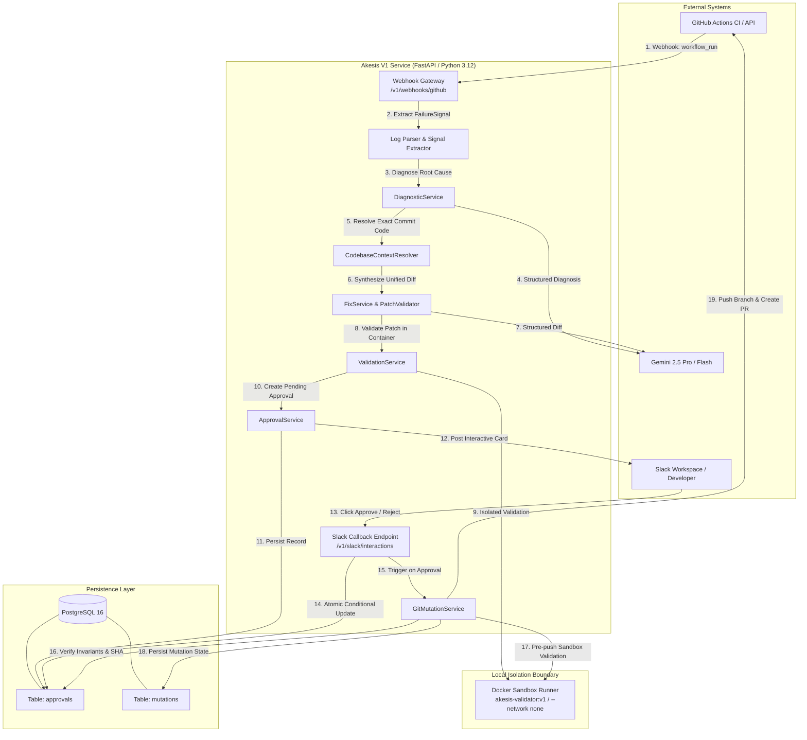

# System Architecture: Akesis V1

```text
Status: Approved V1 Authoritative Architecture
Architecture Style: Modular Monolith / Single-Service Control Plane
Persistence: PostgreSQL 16 (Durable Approval & Mutation State)
Tooling: Python 3.12+ / uv
Logging: structlog with Correlation IDs
```

---

## 1. High-Level System Landscape

Akesis V1 is architected as a modular, safety-first self-healing CI/CD platform. It integrates with GitHub Actions to detect pipeline failures, extract root causes, synthesize minimal code patches, validate fixes in Docker sandboxes, require explicit human authorization, and deliver Pull Requests.

```
Webhook Ingestion ──> Log Parsing ──> Gemini Diagnosis ──> Context Retrieval ──> Fix Synthesis ──> Sandbox Validation ──> Human Approval Gate (Slack / Postgres) ──> Controlled Git Mutation ──> GitHub PR Delivery
```



---

## 2. Core Subsystems & Components

### 2.1 Ingestion & Diagnostic Pipeline
1. **Webhook Gateway (`src/apps/api/routes.py`):** Ingests `workflow_run` events, verifies HMAC-SHA256 signatures and provenance, and persists the verified incident with an empty `FailureSignal` (log status `pending`).
2. **Workflow Log Stage (retry worker, `src/packages/shared/workflow_logs.py`):** Claims pending pipelines, re-verifies their persisted provenance (database only), downloads the verified run attempt's log archive with an `actions:read` installation token (`src/packages/sdk/github_actions_logs.py`), and stores a redacted, bounded `FailureSignal` produced by the Log Parser (`src/packages/shared/log_parser.py`). Outcomes: `extracted`, or `unavailable` with a stable code; transient failures retry with backoff up to `LOG_RETRIEVAL_MAX_ATTEMPTS`.
3. **Diagnostic Engine (`src/packages/shared/diagnostic_service.py`):** Uses structured JSON generation with Gemini to produce evidence-backed `DiagnosisProposal`.
4. **Codebase Context Resolver (`src/packages/shared/context_resolver.py`):** Reads a verified, private snapshot of the exact failing commit (ADR-0011) and extracts bounded `CodeEvidence`.

### 2.2 Synthesis & Sandbox Validation
1. **Fix Proposal Engine (`src/packages/shared/fix_service.py`):** Prompts LLM for minimal unified diffs bounded by strict patch budgets (max 2 files, 100 lines, 4,000 characters).
2. **Patch Validator (`src/packages/shared/patch_validator.py`):** Verifies unified diff syntax, target-file grounding, and blocks protected files (`.github/workflows/`).
3. **Docker Sandbox Runner (`src/packages/sdk/sandbox_runner.py`):** Runs isolated container (`akesis-validator:v1`) with `--network none`, `--cap-drop ALL`, non-root execution, and verbatim `git apply` (no whitespace fixing).
4. **Validation Service (`src/packages/shared/validation_service.py`):** Executes deterministic allowlisted validation commands (`pytest`, `ruff`, `mypy`, `python -m compileall`).

### 2.3 Human-in-the-Loop Approval & PostgreSQL Persistence
1. **Approval Gate (`src/packages/shared/approval_service.py`):** Creates approval records with unique deterministic IDs and dispatches Slack Block Kit cards.
2. **PostgreSQL Persistence (`src/packages/database/`):** Durably stores `approvals` and `mutations` tables with atomic conditional SQL transitions.
3. **Slack Interaction Endpoint (`/v1/slack/interactions`):** Validates Slack HMAC-SHA256 signatures, prevents replay attacks, records decisions, and updates Slack cards in-place.

### 2.4 Controlled Git Mutation & PR Creation
1. **Pre-flight & SHA Verification:** Enforces proposal validity, sandbox validation exit code 0, human approval, and exact commit SHA match.
2. **Same-Repository Only:** Fork-sourced runs (event repository ID differs from source repository ID) are refused before any I/O.
3. **Deterministic Fix Branch:** Generates collision-resistant branch (`akesis/fix/<incident>/<proposal>`) and refuses protected names (`main`, `master`, `develop`, ...).
4. **Snapshot-Based Patch:** Applies the approved patch verbatim to a copy of a verified snapshot of the approved commit, then re-validates it in Docker before any remote write.
5. **GitHub Delivery (`src/packages/sdk/github_git_writer.py`):** With a GitHub App installation token scoped to the event repository, creates blobs, tree and commit through the Git Data API (each verified against local object IDs), creates the branch (never forced), and opens a Pull Request whose base is the exact verified source branch. The source branch must still point at the approved commit before each remote step. Akesis never merges.

---

## 3. Strict Non-Negotiable Safety Boundaries

* **No Autonomous Remediation:** Git mutation cannot execute without an approved `ApprovalRecord`.
* **No Auto-Merge:** Pull Requests require manual human merge on GitHub.
* **No Unrestricted Shell Execution:** Only allowlisted validation commands run inside unprivileged containers.
* **No Distributed Message Brokers:** Uses PostgreSQL and FastAPI background tasks; no Celery, Redis, or Kafka.
