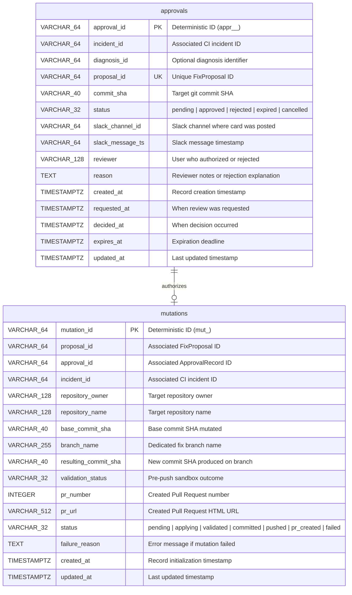

# Low-Level Design (LLD): Akesis V1

```text
Document ID: LLD-001
Status: Authoritative V1 Low-Level Design & Code Specifications
System: Akesis CI/CD Remediation Platform
Target Version: 0.1.0
Decisions Baseline: ADR-0001 through ADR-0007
```

---

## 1. Package & Module Architecture Map

The Akesis codebase is structured as a modular Python package hierarchy under `src/`:

```
src/
├── apps/
│   └── api/
│       ├── __init__.py
│       ├── main.py
│       └── routes.py
└── packages/
    ├── database/
    │   ├── __init__.py
    │   ├── models.py
    │   ├── repositories.py
    │   └── session.py
    ├── sdk/
    │   ├── __init__.py
    │   ├── github_client.py
    │   ├── llm_client.py
    │   ├── repo_checkout.py
    │   ├── sandbox_runner.py
    │   └── slack_client.py
    └── shared/
        ├── __init__.py
        ├── approval_service.py
        ├── config.py
        ├── context_resolver.py
        ├── diagnostic_service.py
        ├── fix_prompt_builder.py
        ├── fix_service.py
        ├── log_parser.py
        ├── logging.py
        ├── models.py
        ├── mutation_service.py
        ├── patch_validator.py
        ├── prompt_builder.py
        └── validation_service.py
```

### Module Specifications

| Module Path | Primary Symbols / Classes | Core Responsibilities & Protocols | Dependencies |
| :--- | :--- | :--- | :--- |
| `src/apps/api/main.py` | `create_app()`, `lifespan()`, `request_correlation_middleware` | FastAPI application lifecycle, health endpoints (`/health/liveness`, `/health/readiness`), request correlation header (`X-Request-ID`). | FastAPI, `structlog`, `database.session` |
| `src/apps/api/routes.py` | `handle_github_webhook()`, `handle_slack_interaction()`, `verify_github_signature()` | Ingests `workflow_run` webhooks and handles interactive Slack callbacks. | `shared.models`, `shared.approval_service`, `shared.log_parser`, `sdk.github_client`, `sdk.slack_client` |
| `src/packages/database/models.py` | `Base`, `ApprovalModel`, `MutationModel` | SQLAlchemy 2.0 async ORM declarations mapping to tables `approvals` and `mutations`. | SQLAlchemy |
| `src/packages/database/repositories.py` | `ApprovalRepositoryProtocol`, `ApprovalRepository`, `MutationRepositoryProtocol`, `MutationRepository` | Atomic conditional SQL persistence for human approval and git mutation entities. | `database.models`, `shared.models`, `sqlalchemy.ext.asyncio` |
| `src/packages/database/session.py` | `get_engine()`, `get_session_factory()`, `get_db_session()` | Async SQLAlchemy engine configuration and FastAPI dependency injection factory. | `sqlalchemy.ext.asyncio`, `shared.config` |
| `src/packages/sdk/llm_client.py` | `LLMClientProtocol`, `GeminiClient`, `LLMError`, `LLMAuthError`, `LLMRateLimitError` | Schema-enforced structured JSON generation adapter calling Google Gemini REST API. | `httpx`, `pydantic`, `shared.config` |
| `src/packages/sdk/github_client.py` | `GitHubClientProtocol`, `GitHubClient`, `GitHubAPIError`, `GitHubResourceNotFoundError` | Async REST client for GitHub API: workflow run logs, commit metadata, search/create Pull Requests. | `httpx`, `shared.config` |
| `src/packages/sdk/repo_checkout.py` | `RepoCheckoutProtocol`, `GitRepositoryCheckoutManager`, `InvalidCommitError` | Clones and checks out exact target commit SHAs in detached HEAD working trees. | `gitpython`, `shared.config` |
| `src/packages/sdk/sandbox_runner.py` | `SandboxRunnerProtocol`, `DockerSandboxRunner`, `DockerUnavailableError`, `SandboxTimeoutError`, `PatchApplicationError` | Materializes ephemeral workspaces, applies verbatim unified diffs, and executes container validation. | `asyncio`, `shared.config`, `shared.models` |
| `src/packages/sdk/slack_client.py` | `SlackClientProtocol`, `SlackClient`, `verify_slack_signature()`, `SlackError` | Dispatches Block Kit approval cards, updates message cards via `response_url`, and verifies HMAC signatures. | `httpx`, `shared.config`, `shared.models` |
| `src/packages/shared/config.py` | `Settings`, `settings` | Typed application settings loaded from environment variables using `pydantic-settings`. | `pydantic_settings` |
| `src/packages/shared/models.py` | `FailureCategory`, `FailureSignal`, `FailureContext`, `CodeEvidence`, `EvidencePackage`, `DiagnosisProposal`, `DiagnosticResult`, `FixProposal`, `ValidationResult`, `ApprovalRecord`, `MutationRecord` | Domain Pydantic models, enums, and data schemas across all pipeline stages. | `pydantic` |
| `src/packages/shared/log_parser.py` | `filter_and_extract_signal()`, `strip_ansi_codes()` | Regex-based ANSI stripping and failure signal extraction (Python traceback, Pytest, Ruff, Mypy, Pip). | `shared.models` |
| `src/packages/shared/context_resolver.py` | `CodebaseContextResolver`, `normalize_repo_relative_path()`, `is_path_safe_and_within_root()` | Resolves target files at commit SHA, enforces path security, and extracts bounded code snippets. | `sdk.repo_checkout`, `shared.models`, `shared.config` |
| `src/packages/shared/prompt_builder.py` | `DiagnosticPromptBuilder` | Builds deterministic system instructions and evidence-grounded user prompts for diagnosis. | `shared.models` |
| `src/packages/shared/diagnostic_service.py` | `DiagnosticService` | Coordinates context resolution, prompt creation, Gemini structured generation, and fallback handling. | `sdk.llm_client`, `shared.context_resolver`, `shared.prompt_builder`, `shared.models` |
| `src/packages/shared/fix_prompt_builder.py` | `FixPromptBuilder` | Builds system instructions and evidence prompts for minimal unified diff synthesis. | `shared.models` |
| `src/packages/shared/patch_validator.py` | `PatchValidator`, `PatchValidationResult` | Parses unified diffs into `FilePatch`/`PatchHunk`, enforces budget caps, and checks evidence grounding. | `shared.models`, `shared.config` |
| `src/packages/shared/fix_service.py` | `FixProposalService` | Coordinates diagnostic eligibility checking, fix prompt creation, LLM synthesis, and patch validation. | `sdk.llm_client`, `shared.patch_validator`, `shared.fix_prompt_builder`, `shared.models` |
| `src/packages/shared/validation_service.py` | `ValidationService` | Maps failure category to allowlisted validation command and orchestrates sandbox runner. | `sdk.sandbox_runner`, `sdk.repo_checkout`, `shared.models` |
| `src/packages/shared/approval_service.py` | `ApprovalService`, `IneligibleApprovalError`, `IllegalStateTransitionError` | Evaluates eligibility, creates pending records, dispatches Slack cards, and commits decisions. | `database.repositories`, `sdk.slack_client`, `shared.models` |
| `src/packages/shared/mutation_service.py` | `GitMutationService`, `PreflightCheckError`, `StaleCommitError`, `UnsafeBranchError` | Manages git branch creation, patch application, pre-push validation, commit, push, and PR opening. | `database.repositories`, `sdk.github_client`, `sdk.repo_checkout`, `sdk.sandbox_runner`, `shared.models` |

---

## 2. Runtime Call Flow & Sequence Diagram

The following sequence diagram traces the complete runtime execution path through real functions and symbols:

```mermaid
sequenceDiagram
    autonumber
    participant GHA as GitHub Actions
    participant Routes as src.apps.api.routes
    participant Parser as src.packages.shared.log_parser
    participant GHClient as src.packages.sdk.github_client.GitHubClient
    participant DiagSvc as src.packages.shared.diagnostic_service.DiagnosticService
    participant CtxRes as src.packages.shared.context_resolver.CodebaseContextResolver
    participant LLM as src.packages.sdk.llm_client.GeminiClient
    participant FixSvc as src.packages.shared.fix_service.FixProposalService
    participant PatchVal as src.packages.shared.patch_validator.PatchValidator
    participant ValSvc as src.packages.shared.validation_service.ValidationService
    participant BoxRun as src.packages.sdk.sandbox_runner.DockerSandboxRunner
    participant ApprSvc as src.packages.shared.approval_service.ApprovalService
    participant ApprRepo as src.packages.database.repositories.ApprovalRepository
    participant Slack as src.packages.sdk.slack_client.SlackClient
    participant MutSvc as src.packages.shared.mutation_service.GitMutationService
    participant MutRepo as src.packages.database.repositories.MutationRepository

    %% Ingestion
    GHA->>Routes: POST /v1/webhooks/github
    Note over Routes: verify_github_signature(payload, sig, secret)
    Routes->>GHClient: get_workflow_run_logs(owner, repo, run_id)
    GHClient-->>Routes: raw_logs
    Routes->>Parser: filter_and_extract_signal(raw_logs)
    Parser-->>Routes: FailureSignal
    Note over Routes: Construct FailureContext(incident_id, commit_sha, signal)
    Routes-->>GHA: IngestionResponse(status="accepted", incident_id)

    %% Diagnostic & Context Pipeline
    Routes->>DiagSvc: diagnose_failure(context)
    DiagSvc->>CtxRes: resolve_context(context)
    CtxRes-->>DiagSvc: EvidencePackage(code_evidences)
    DiagSvc->>LLM: generate_structured(prompt, DiagnosisProposal)
    LLM-->>DiagSvc: DiagnosisProposal
    DiagSvc-->>Routes: DiagnosticResult

    %% Fix Synthesis & Validation
    Routes->>FixSvc: generate_fix_proposal(context, diag_result, evidence_package)
    FixSvc->>LLM: generate_structured(fix_prompt, RawFixProposal)
    LLM-->>FixSvc: RawFixProposal(unified_diff)
    FixSvc->>PatchVal: validate_patch(diff, target_files, evidence)
    PatchVal-->>FixSvc: PatchValidationResult(is_valid=True)
    FixSvc-->>Routes: FixProposal

    Routes->>ValSvc: validate_fix(proposal, context)
    ValSvc->>BoxRun: run_validation(repo_dir, diff, command)
    BoxRun-->>ValSvc: ValidationExecutionResult(exit_code=0)
    ValSvc-->>Routes: ValidationResult(status=ValidationStatus.PASSED)

    %% Human Approval Gate
    Routes->>ApprSvc: request_approval(context, proposal, validation)
    ApprSvc->>ApprRepo: create_approval(ApprovalRecord: pending)
    ApprRepo-->>ApprSvc: ApprovalRecord
    ApprSvc->>Slack: post_approval_card(approval, context, proposal, validation)
    Slack-->>ApprSvc: {"channel_id": "...", "message_ts": "..."}

    %% Reviewer Callback
    GHA->>Routes: POST /v1/slack/interactions (Approve Click)
    Note over Routes: verify_slack_signature(body, timestamp, sig)
    Routes->>ApprSvc: record_decision(approval_id, "approve", user, response_url)
    ApprSvc->>ApprRepo: record_decision(approval_id, APPROVED, user)
    ApprRepo-->>ApprSvc: (updated_record, is_duplicate=False)
    ApprSvc->>Slack: update_approval_card(response_url, record)

    %% Mutation & PR
    Routes->>MutSvc: create_pull_request(context, proposal, validation, approval)
    Note over MutSvc: verify_preflight_invariants()<br/>validate_branch_name()<br/>Check repo HEAD == commit_sha
    MutSvc->>MutRepo: create_mutation(MutationRecord: pending)
    MutSvc->>BoxRun: run_validation (Pre-push verification)
    BoxRun-->>MutSvc: Exit code 0
    MutSvc->>GHClient: create_pull_request(owner, repo, title, body, head, base)
    GHClient-->>MutSvc: {"number": 12, "html_url": "..."}
    MutSvc->>MutRepo: update_status(mutation_id, PR_CREATED, pr_number=12)
    MutSvc-->>Routes: MutationRecord(status=PR_CREATED, pr_number=12)
```



---

## 3. Database Schema & Data Models

### 3.1 Entity-Relationship Diagram



### 3.2 Database Indexes & Constraints
1. **`approvals` Table:**
   - Primary Key: `approval_id`
   - Unique Index: `proposal_id` (enforces 1:1 proposal-to-approval binding)
   - Index: `ix_approvals_incident_id` on `(incident_id)`
   - Composite Index: `ix_approvals_status_expires` on `(status, expires_at)`
2. **`mutations` Table:**
   - Primary Key: `mutation_id`
   - Index: `ix_mutations_proposal_id` on `(proposal_id)`
   - Index: `ix_mutations_approval_id` on `(approval_id)`
   - Index: `ix_mutations_status` on `(status)`
   - Composite Index: `ix_mutations_proposal_commit` on `(proposal_id, base_commit_sha)`

---

## 4. State Machines & Invariant Enforcements

### 4.1 Approval Lifecycle State Machine

```
              ┌────────────────────────┐
              │        PENDING         │
              └───────────┬────────────┘
                          │
         ┌────────────────┼────────────────┬────────────────┐
         │ (Approve click)│ (Reject click) │ (TTL Expiry)   │ (Cancel)
         ▼                ▼                ▼                ▼
  ┌────────────┐   ┌────────────┐   ┌────────────┐   ┌────────────┐
  │  APPROVED  │   │  REJECTED  │   │  EXPIRED   │   │ CANCELLED  │
  └────────────┘   └────────────┘   └────────────┘   └────────────┘
```

#### Transition Invariants:
* **Legal Transitions:** Only records in `PENDING` status may transition to `APPROVED`, `REJECTED`, `EXPIRED`, or `CANCELLED`.
* **Atomic Conditional Update:** Executed in `ApprovalRepository.record_decision`:
  ```sql
  UPDATE approvals
  SET status = :target_status, reviewer = :reviewer, reason = :reason, decided_at = :now, updated_at = :now
  WHERE approval_id = :approval_id AND status = 'pending'
  RETURNING *;
  ```
* **Idempotency:** If the record is already in `target_status`, the repository returns `(record, is_duplicate=True)` without raising an error.
* **Illegal Transition Guard:** If the record is in a conflicting terminal state (e.g., trying to approve a rejected record), an `IllegalStateTransitionError` is raised, returning HTTP `409 Conflict`.

---

### 4.2 Git Mutation Lifecycle State Machine

```
PENDING ──► APPLYING ──► VALIDATED ──► COMMITTED ──► PUSHED ──► PR_CREATED
   │            │            │             │            │           │
   └────────────┴────────────┴─────────────┴────────────┴───────────┴──► FAILED
```

#### Mutation Invariants:
1. **Preflight Check:** Proposal must have `is_valid=True`, validation must have `status=PASSED` and `exit_code=0`, and approval must have `status=APPROVED`.
2. **SHA Consistency:** `approval.commit_sha == proposal.commit_sha == context.commit_sha == repo.head.commit.hexsha`.
3. **Branch Protection:** Fix branch name (`akesis/fix/<incident>/<proposal>`) cannot match `main`, `master`, `develop`, `release`, `production`, or `staging`.
4. **Scope Integrity:** After patch application, `repo.untracked_files` must be empty, and all modified files must strictly belong to `proposal.target_files`.
5. **Pre-Push Docker Validation:** `ValidationService.validate_fix()` re-executes container verification on the patched working tree prior to `git push`.

---

## 5. Security & Cryptographic Verifications

### 5.1 GitHub Inbound HMAC Verification
```python
def verify_github_signature(
    payload_bytes: bytes, signature_header: str | None, secret: str
) -> bool:
    if not signature_header or not secret or not signature_header.startswith("sha256="):
        return False
    expected = signature_header.removeprefix("sha256=")
    computed = hmac.new(secret.encode("utf-8"), payload_bytes, hashlib.sha256).hexdigest()
    return hmac.compare_digest(computed, expected)
```

### 5.2 Slack Interaction Signature & Replay Prevention
```python
def verify_slack_signature(
    raw_body: bytes,
    timestamp: str | None,
    signature: str | None,
    signing_secret: str,
    max_age_seconds: int = 300,
) -> bool:
    if not timestamp or not signature or not signing_secret:
        return False
    if abs(int(time.time()) - int(timestamp)) > max_age_seconds:
        return False
    sig_basestring = f"v0:{timestamp}:{raw_body.decode('utf-8', errors='replace')}"
    computed = (
        "v0="
        + hmac.new(
            signing_secret.encode("utf-8"), sig_basestring.encode("utf-8"), hashlib.sha256
        ).hexdigest()
    )
    return hmac.compare_digest(computed, signature)
```

---

## 6. Patch Validation & Docker Sandbox Execution Rules

### 6.1 Bounded Patch Budgets
* **Maximum Target Files:** 2 files (`settings.max_fix_target_files = 2`).
* **Maximum Unified Diff Lines:** 100 lines (`settings.max_patch_lines = 100`).
* **Maximum Patch Characters:** 4,000 characters (`settings.max_patch_chars = 4000`).
* **Confidence Threshold:** Minimum 0.60 (`settings.min_fix_confidence_threshold = 0.60`).

### 6.2 Protected Path Rules
Any patch touching the following patterns is rejected immediately by `PatchValidator`:
* `^\.github/workflows/` (GitHub Actions workflow files)
* `^\.git/` (Git metadata)
* `^\.env(\..+)?$` (Environment and secret files)
* Binary extensions: `.exe`, `.dll`, `.so`, `.dylib`, `.bin`, `.pyc`, `.pyd`, `.whl`, `.zip`, `.png`, `.jpg`

### 6.3 Allowlisted Validation Commands
| Failure Category | Extracted Error Clues | Validation Command Invoked |
| :--- | :--- | :--- |
| `FailureCategory.LINT` | `mypy`, `TypeError`, `Type` | `mypy .` |
| `FailureCategory.LINT` | Standard lint violations | `ruff check .` |
| `FailureCategory.TEST` | Pytest assertion / test errors | `pytest -v` |
| `FailureCategory.DEPENDENCY` / `BUILD` | Missing modules / syntax | `python3 -m compileall .` |

---

## 7. Error Translation & Exception Hierarchy

```
Exception
├── LLMError
│   ├── LLMAuthError (401/403)
│   ├── LLMRateLimitError (429)
│   ├── LLMTimeoutError
│   └── LLMResponseValidationError
├── GitHubAPIError
│   ├── GitHubAuthError (401)
│   ├── GitHubPermissionError (403)
│   ├── GitHubRateLimitError (429)
│   ├── GitHubResourceNotFoundError (404)
│   └── GitHubConflictError (409/422)
├── RepositoryCheckoutError
│   ├── InvalidCommitError
│   └── RepositoryNotFoundError
├── SandboxError
│   ├── DockerUnavailableError
│   ├── SandboxTimeoutError
│   ├── PatchApplicationError
│   └── SandboxWorkspaceError
├── ApprovalError
│   ├── IneligibleApprovalError
│   ├── IllegalStateTransitionError (409)
│   └── ApprovalNotFoundError (404)
└── MutationError
    ├── PreflightCheckError
    ├── StaleCommitError
    ├── UnsafeBranchError
    ├── WorkingTreeMismatchError
    ├── PrePushValidationError
    └── GitPushError
```

---

## 8. Test Suite Mapping & Verification Matrix

The repository maintains strict unit and integration test coverage across all subsystems:

| Test File | Subsystem Verified | Key Invariants Asserted |
| :--- | :--- | :--- |
| `tests/unit/test_webhook_security.py` | Ingestion Gateway | HMAC-SHA256 signature verification, rejection of invalid/missing signatures. |
| `tests/unit/test_event_normalization.py` | Event Ingestion | Normalization of `workflow_run` JSON into `WorkflowRunEvent`. |
| `tests/unit/test_log_parser.py` | Signal Parsing | ANSI stripping, traceback extraction, Pytest/Ruff/Mypy/Pip pattern matching. |
| `tests/unit/test_repo_checkout.py` | Code Context | Commit SHA format validation, detached HEAD checkout verification. |
| `tests/unit/test_context_resolver.py` | Code Context | Line windowing, path traversal blocking (`is_path_safe_and_within_root`), character budget caps. |
| `tests/unit/test_gemini_client.py` | AI SDK Client | Pydantic JSON schema generation, error translations (auth, rate limits, timeouts). |
| `tests/unit/test_prompt_builder.py` | AI Prompting | Passive untrusted data wrapping, prompt injection boundary formatting. |
| `tests/unit/test_diagnostic_service.py` | AI Diagnosis | Structured diagnosis, confidence clamping, fallback on LLM failure. |
| `tests/unit/test_diagnostic_scenarios.py` | AI Diagnosis | Real-world failure scenario fixtures (pytest, ruff, mypy, pip, unclassified). |
| `tests/unit/test_fix_prompt_builder.py` | Fix Synthesis | Evidence-grounded fix prompt generation. |
| `tests/unit/test_patch_validator.py` | Patch Validation | Diff parsing, target file grounding, protected file blocking, line/char budgets. |
| `tests/unit/test_fix_service.py` | Fix Synthesis | Eligibility checks, structured fix generation, rejection formatting. |
| `tests/unit/test_sandbox_runner.py` | Sandbox SDK | Ephemeral workspace lifecycle, verbatim `git apply` checks, timeout handling. |
| `tests/unit/test_validation_service.py` | Sandbox Validation | Command selection matrix, outcome mapping (`passed`, `failed`, `patch_rejected`). |
| `tests/unit/test_slack_client.py` | Human Gate SDK | Block Kit card building, signature verification, 300s replay window check. |
| `tests/unit/test_approval_service.py` | Human Gate Service | Eligibility gating, atomic state transitions, duplicate idempotency, TTL expiration. |
| `tests/unit/test_github_client.py` | GitHub SDK | Log streaming, commit fetching, PR search and creation error handling. |
| `tests/unit/test_mutation_service.py` | Git Mutation | Preflight checks, SHA matching, branch safety, pre-push Docker validation, PR generation. |
| `tests/integration/test_webhook_api.py` | Ingestion API | FastAPI test client verification of webhook ingress and signature gating. |
| `tests/integration/test_database_repository.py` | Persistence | PostgreSQL async persistence, atomic SQL transitions, duplicate handling. |
| `tests/integration/test_approval_flow.py` | End-to-End Approval | Integration flow between approval service, Slack callback, and database. |
| `tests/integration/test_mutation_flow.py` | End-to-End Mutation | Full integration flow from approved state to git branch mutation. |
| `tests/integration/test_docker_sandbox.py` | Container Sandbox | Live Docker daemon execution of `akesis-validator:v1`. |
